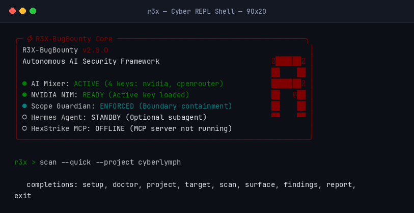
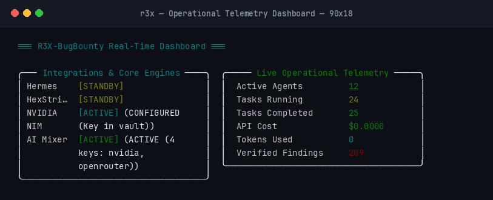
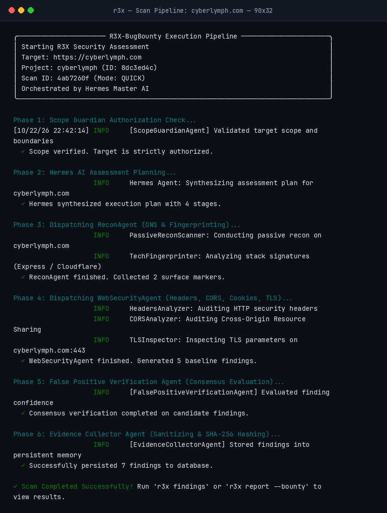
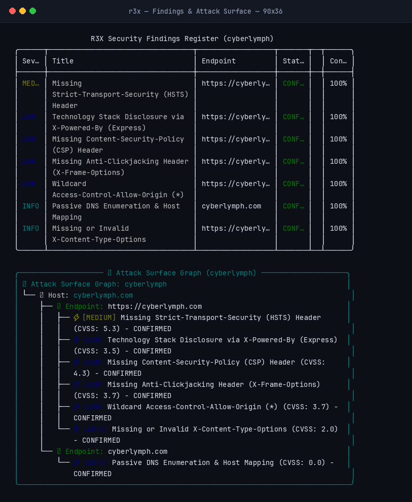
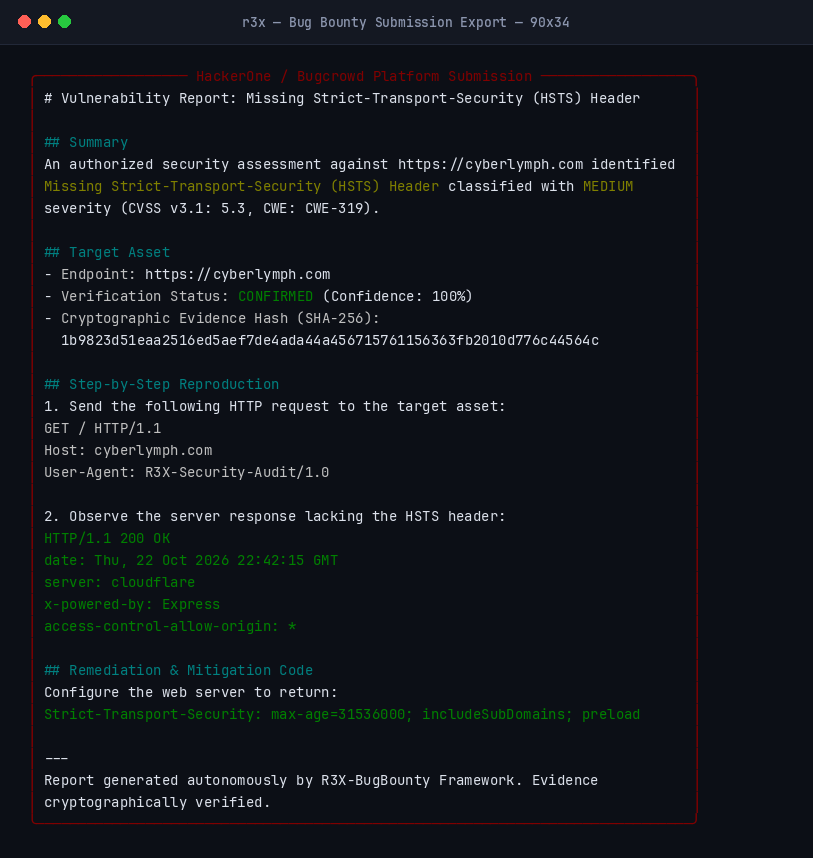
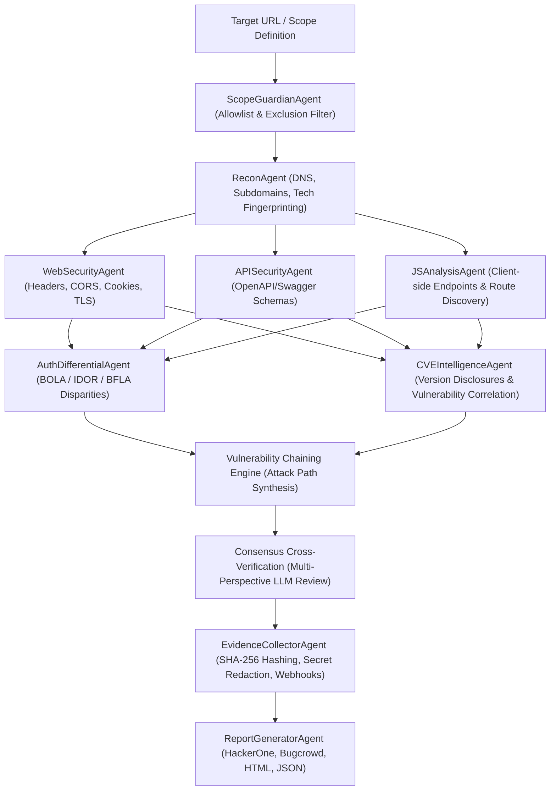

<div align="center">


# R3X-BugBounty — Multi-Agent AI Security Auditing Framework
### Modular, Terminal-Native Web Application Security Assessment & Bug Bounty Platform

[](https://www.python.org/)
[](LICENSE)
[](https://github.com/r3xdec-bit/r3x-bugbounty/actions/workflows/ci.yml)
[](https://github.com/astral-sh/ruff)
[](https://github.com/PyCQA/bandit)

[English](README.md) • [العربية](github/README_AR.md) • [Architecture](github/ARCHITECTURE.md) • [Installation Guide](github/INSTALLATION.md) • [Changelog](github/CHANGELOG.md)

</div>

---

## 🎯 Overview

**R3X-BugBounty** is an open-source, terminal-based security auditing framework designed for security researchers, penetration testers, and Bug Bounty hunters. It coordinates established open-source security tools and specialized autonomous AI agents to conduct structured, authorized web application assessments.

The framework emphasizes **strict scope enforcement**, **empirical evidence collection**, **user consent before downloading any external tool**, and **reproducible reporting** formatted directly for platforms such as HackerOne, Bugcrowd, and Intigriti.

> [!IMPORTANT]
> **Strictly for Authorized Testing**: R3X is an auditing and assessment tool, not an exploitation framework. It contains zero weaponized exploit payloads, brute-force engines, or denial-of-service capabilities. Assessments must only be performed on systems you own or have explicit written permission to test.

---

## 📸 Live Terminal Interface & Screenshots

<details open>
<summary><b>1. Cyber REPL Shell & Minimalist Terminal Banner</b></summary>
<br>
<p align="center">
  
</p>
</details>

<details open>
<summary><b>2. Real-Time Operational Telemetry Dashboard (<code>r3x dashboard</code>)</b></summary>
<br>
<p align="center">
  
</p>
</details>

<details open>
<summary><b>3. Live Assessment Execution Pipeline against Target (<code>cyberlymph.com</code>)</b></summary>
<br>
<p align="center">
  
</p>
</details>

<details open>
<summary><b>4. Security Findings Register & Attack Surface Graph</b></summary>
<br>
<p align="center">
  
</p>
</details>

<details open>
<summary><b>5. Bug Bounty Platform Submission Report (HackerOne / Bugcrowd Format)</b></summary>
<br>
<p align="center">
  
</p>
</details>

---

## 💻 System Requirements & Supported Platforms

| Component | Minimum Requirement | Notes |
|---|---|---|
| **Operating System** | Linux / WSL | Kali Linux, Arch Linux, Ubuntu (20.04+), Debian (11+), Fedora (38+), openSUSE, WSL 1 & 2 |
| **Python** | 3.11 or 3.12 | Tested on Python 3.11, 3.12, and 3.14 |
| **Privileges** | Standard User | Runs in user-space (`~/.local/bin` and isolated virtualenv). Does **not** require root/sudo for daily operation |
| **Storage & RAM** | 512 MB RAM / 250 MB Disk | Lightweight asynchronous core designed for resource-constrained laptops and VPS |

---

## 🛠️ Security Tool Integrations & Consent Policy

R3X leverages industry-standard security utilities. **Missing tools are never downloaded silently.** R3X checks your local `$PATH` first; if a tool is absent, it asks for your explicit interactive confirmation (`y/N`), displays the download URL, verifies the package, and places the binary cleanly into `~/.local/bin` or the project `bin/` directory.

| Tool | Purpose | Source / Provider | Note on Scope |
|---|---|---|---|
| **Nmap** | Port scanning & service version discovery | System package manager (`apt`, `pacman`, `dnf`) | Standard TCP discovery |
| **WhatWeb** | Web technology & CMS identification | Official GitHub release | Passive web header analysis |
| **Nuclei** | Template-based vulnerability auditing | ProjectDiscovery | Verified vulnerability patterns |
| **httpx (Binary)** | Web server probe & status code inspection | ProjectDiscovery | *Distinct from the Python `httpx` HTTP library* |
| **Subfinder** | Passive subdomain enumeration | ProjectDiscovery | Passive sources only (DNS-safe) |
| **Katana** | Web crawling & endpoint mapping | ProjectDiscovery | Follows in-scope links only |
| **Amass** | External asset mapping & DNS analysis | OWASP | Passive and active mapping |
| **SSLyze** | TLS/SSL cipher suites & cert audit | PyPI / Binary | Cryptographic configuration check |
| **dnsx** | Multi-purpose DNS resolver & query tool | ProjectDiscovery | Fast DNS validation |

---

## 🤖 The 12 Autonomous Agents

Each assessment phase is coordinated by dedicated Python agents with strictly partitioned roles:



| # | Agent Name | Technical Responsibility |
|---|---|---|
| 1 | **HermesMasterOrchestrator** | Task delegation, assessment step scheduling, and historical context management |
| 2 | **ScopeGuardianAgent** | Verifies domain allowlists, enforces URL exclusions, and blocks out-of-scope redirects |
| 3 | **ReconAgent** | Coordinates passive DNS queries, subdomain enumeration, and tech stack fingerprinting |
| 4 | **WebSecurityAgent** | Audits HTTP security headers (HSTS, CSP), CORS configurations, Cookie attributes, and TLS parameters |
| 5 | **APISecurityAgent** | Identifies REST and GraphQL endpoints, parses exposed OpenAPI/Swagger schemas, and tests schema compliance |
| 6 | **JSAnalysisAgent** | Statically analyzes client-side JavaScript bundles to extract hidden API paths and disclosed endpoints |
| 7 | **AuthDifferentialAgent** | Differential authorization auditor: compares response codes and payloads across anonymous, low-privilege, and high-privilege roles to identify BOLA/IDOR and BFLA disparities |
| 8 | **CVEIntelligenceAgent** | Correlates discovered software versions with public vulnerability feeds and advisory records |
| 9 | **FalsePositiveVerificationAgent** | Submits proposed findings to a multi-perspective consensus prompt (evaluating reproducibility and evidence strength) to filter out scanner false positives |
| 10 | **EvidenceCollectorAgent** | Redacts sensitive credentials (tokens, passwords), computes cryptographic SHA-256 evidence hashes, dispatches webhook alerts, and commits findings to SQLite |
| 11 | **AIMixerAgent** | Handles multi-key rotation, manages financial budget limits (`BudgetGuard`), and selects models based on task latency and cost |
| 12 | **ReportGeneratorAgent** | Compiles verified findings into executive HTML, PDF, JSON, and platform-compliant Markdown for HackerOne, Bugcrowd, and Intigriti |

---

## 🔑 AI Integrations & Local Key Management

R3X can operate with cloud AI providers or entirely offline using local models:

- **Supported Providers**: NVIDIA NIM, OpenRouter, OpenAI, Google Gemini, and local **Ollama** (offline/air-gapped).
- **Local Fernet Vault**: API keys are encrypted at rest using machine-derived Fernet symmetric encryption stored in `~/.r3x/vault.enc`. Keys are never sent to external servers other than the configured provider endpoint.
- **Budget Guard**: Set a hard financial limit on LLM usage (e.g. `$5.00`). If consumption reaches the threshold, further LLM calls are blocked immediately to prevent unexpected costs.
- **Dynamic Task Routing**: Automatically routes fast reconnaissance tasks to lightweight models and deep reporting/chaining to reasoning models.

---

## 🚀 Quick Start

### 1. Automated Installation
Run the interactive installer supporting Kali, Arch, Debian, Ubuntu, Fedora, openSUSE, and WSL:

```bash
git clone https://github.com/r3xdec-bit/r3x-bugbounty.git
cd r3x-bugbounty
chmod +x install.sh
./install.sh
```

The installer verifies your distribution, checks installed tools, prompts before installing anything missing, creates an isolated Python virtual environment (`.venv`), and verifies binary execution paths.

### 2. Launch the Interactive Cyber REPL
```bash
source .venv/bin/activate
r3x
```

---

## 🛠️ Typical Assessment Workflow

### Step 1: Initialize Project & Define Scope
```bash
# Create an isolated assessment workspace
r3x project new client-audit --description "Authorized external web audit"

# Add target base URL
r3x target add https://target.example.com --project client-audit

# Import scope rules (allowlist domains and excluded paths like logout or oauth)
r3x scope import scope.json --project client-audit
```

### Step 2: Configure AI Providers & Budget
```bash
# Add API key (saved encrypted in local vault)
r3x mixer add nvidia
r3x mixer add openrouter

# Review active keys, quotas, and providers
r3x mixer status
```

### Step 3: Run the Assessment
```bash
# Quick passive reconnaissance & header audit
r3x scan --quick --project client-audit

# Comprehensive scan (Recon + Web + API + JS + Differential Auth + CVE)
r3x scan --full --project client-audit

# Check operational dashboard
r3x dashboard
```

### Step 4: Review Findings & Attack Surface Topology
```bash
# View confirmed findings with severity ratings
r3x findings --project client-audit

# Inspect cryptographically hashed evidence artifacts
r3x evidence

# Visualize the discovered target topology tree
r3x surface --project client-audit
```

### Step 5: Export Platform-Ready Reports
```bash
# Generate submissions ready for HackerOne / Bugcrowd / Intigriti
r3x report --bounty --project client-audit

# Generate executive HTML or structured JSON reports
r3x report --html --project client-audit
r3x report --json --project client-audit
```

---

## 🔔 Webhook Notifications

Configure real-time alerts for identified findings directly to your triage channel:
- **Slack**: Formatted blocks with severity color coding.
- **Discord**: Embedded cards with CVSS ratings and affected endpoints.
- **Telegram**: Structured markdown notifications.

*All webhook dispatches pass through the automated secrets sanitizer, redacting Authorization Bearer tokens, private keys, and passwords before transmission.*

---

## 🛡️ Defensive Boundaries & Guardrails

1. **Strict Domain Containment**: Out-of-scope HTTP requests are blocked before socket creation by the `ScopeGuardian`.
2. **Emergency Pause & Resume**: Any scan can be paused immediately (`Ctrl+C` or `r3x pause`), persisting current state in SQLite for later resumption with `r3x resume`.
3. **No Exploits**: Findings document vulnerabilities and provide reproduction requests without weaponized exploit payloads.
4. **Prompt Injection Defense**: Target responses are treated as untrusted data, sanitized, and wrapped in delimited XML blocks before LLM processing.

---

## 🧪 Testing & Verification

The framework includes a comprehensive test suite covering CLI commands, AI edge cases, provider timeouts, rate-limit backoff, and scanner functionality:

```bash
# Run the complete test suite (41 unit & integration tests)
pytest -v

# Run static security audit
bandit -r r3x/

# Run code style and lint check
ruff check r3x/ tests/
```

---

## 📄 License & Attribution

Distributed under the **MIT License**. See [LICENSE](LICENSE) for details.

Developed for the cybersecurity community, penetration testers, and ethical Bug Bounty researchers.
