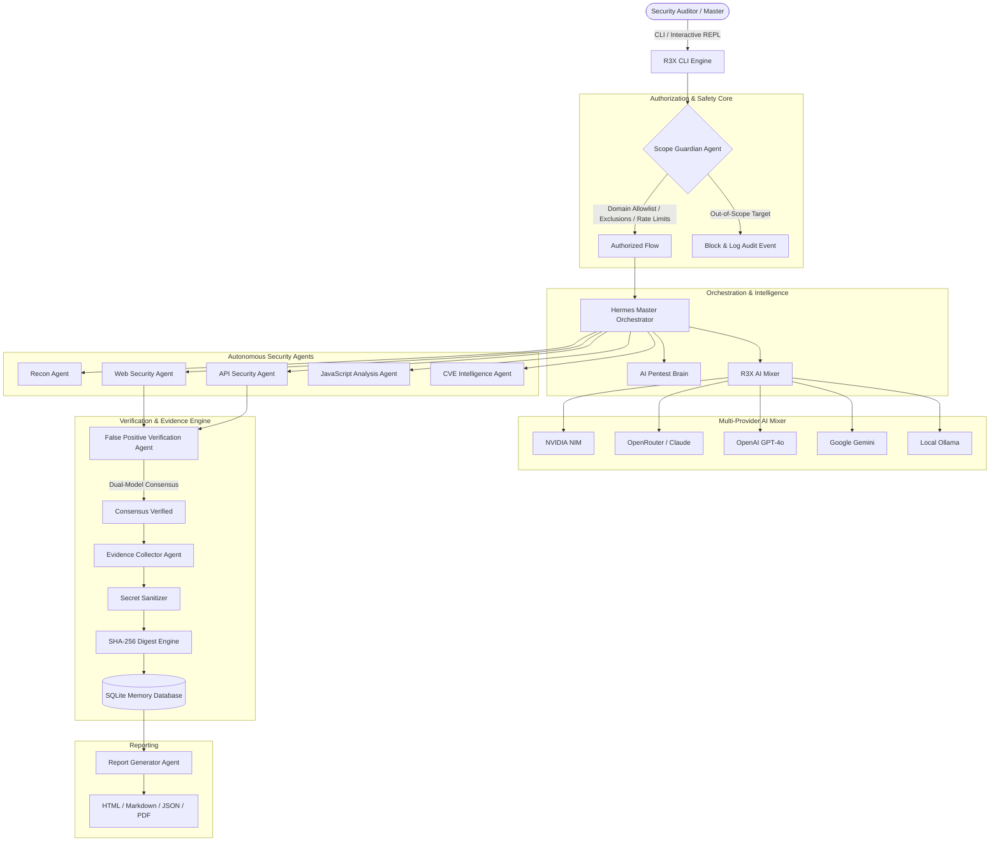

# R3X-BugBounty Architecture Specification

`R3X-BugBounty` is designed around an autonomous multi-agent hierarchy enforcing strict scope containment and empirical evidence verification.

## 1. High-Level System Architecture

## 2. Scope Guardian Gate

Every network action is intercepted by `ScopeGuardian`:
1. **Target Allowlist:** Matching against explicit domain and approved wildcard subdomains.
2. **Exclusion Traps:** Strict checks against `*.gov`, `*.mil`, sensitive endpoints (`logout`, `delete`, `shutdown`).
3. **Redirect Protection:** Inspects all `Location` HTTP headers; terminates requests if redirection attempts to escape the authorized scope.
4. **Emergency Stop:** Immediate halt mechanism callable globally.

## 3. Evidence-First Integrity & Multi-Agent Debate

Findings are never admitted based purely on language model speculation:
- **Empirical Trace Verification:** Raw HTTP request and response evidence captured directly from target interactions.
- **Automatic Secrets Redaction:** Automatic stripping of Bearer tokens, API credentials, sensitive cookies, and passwords.
- **Cryptographic SHA-256 Digest:** Evidence hashing ensuring integrity and non-repudiation.
- **Multi-Agent Adversarial Debate:** High and critical severity claims undergo a 3-agent dialectic trial (Prosecutor vs Defender adjudicated by Chief Judge) to eradicate false positives.

## 4. V2 Cognitive & Resilience Architecture

### 4.1 R3X Neural Brain & Topology Graph
- **Attack Chain Correlation:** Synthesizes isolated low-risk issues (e.g. CORS reflection + token leak in JS) into high-impact lateral vectors.
- **Interactive Topology Graph:** NetworkX-powered target visualization with terminal tree rendering.

### 4.2 AI Mixer V2 & Budget Guard
- **Real-Time Financial Guardrails:** `BudgetGuard` enforces strict hard dollar limits on API calls.
- **Dynamic Model Scoring:** Multi-attribute evaluation weighing latency, cost, stability, and reasoning affinity.
- **State-Preserving Fallback:** Seamlessly shifts to alternate providers without losing conversational context.

### 4.3 Self-Healing & Optimization Core
- **Safe Failure Diagnosis:** Analyzes missing binaries, HTTP 429 rate limits, and network timeouts with automated exponential backoff.
- **Scan Optimizer:** Dynamically analyzes target protocols to omit redundant scanner invocations.
- **Plugin Architecture:** Sandboxed plugin marketplace with strict privilege containment.
