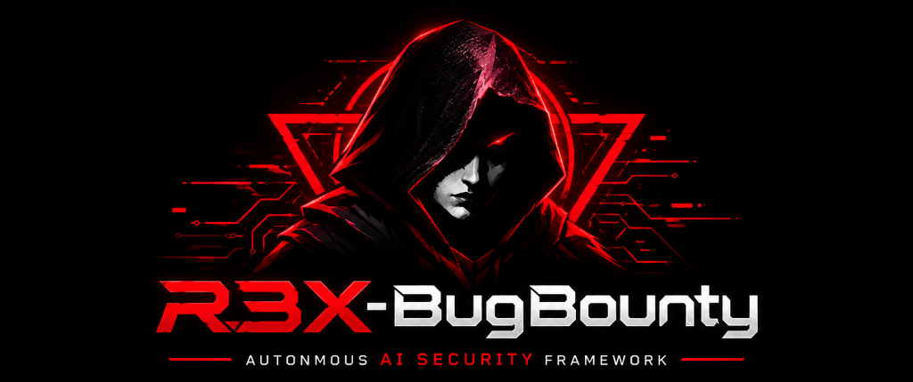

<div align="center" dir="rtl">



# R3X-BugBounty — إطار عمل تدقيق أمني وفحص ثغرات متعدد الوكلاء
### منصة تقييم أمني وتدقيق تطبيقات الويب وبرامج مكافآت الثغرات تعمل عبر الطرفية (CLI)

[](https://www.python.org/)
[](LICENSE)
[](https://github.com/r3xdec-bit/r3x-bugbounty/actions/workflows/ci.yml)
[](https://github.com/astral-sh/ruff)
[](https://github.com/PyCQA/bandit)

[English](../README.md) • [العربية](README_AR.md) • [المعمارية التقنية](ARCHITECTURE.md) • [دليل التثبيت](INSTALLATION.md) • [سجل التغييرات](CHANGELOG.md)

</div>

---

## 🎯 نظرة عامة وموضوعية

**R3X-BugBounty** هو إطار عمل مفتوح المصدر يعمل بالكامل من خلال الطرفية (Terminal)، موجّه لمختبري الاختراق وباحثي الأمن السيبراني وصائدي الثغرات (Bug Bounty Hunters). ينسق الإطار عمل الأدوات الأمنية القياسية مفتوحة المصدر مع 12 وكيلاً برمجياً متخصصاً مدعوماً بنماذج الذكاء الاصطناعي لإجراء عمليات تقييم أمني منظمة ومصرح بها لتطبيقات الويب.

يركز النظام على **الالتزام الصارم بنطاق الفحص المصرح به (Scope)**، و**جمع الأدلة الواقعية والتأكد من صحتها**، و**طلب موافقة المستخدم المسبقة والصريحة قبل تحميل أي أداة خارجية**، وتوليد تقارير مهيأة تقنياً للرفع المباشر على منصات مكافآت الثغرات مثل HackerOne و Bugcrowd.

> [!IMPORTANT]
> **مخصص فقط للاختبارات المصرح بها**: R3X هو إطار عمل للتدقيق وتقييم الثغرات (Auditing & Assessment) وليس أداة استغلال أو اختراق تخريبي. لا يحتوي المشروع على أي برمجيات استغلال مدمرة (Exploits)، أو أدوات هجوم تخمين بالقوة الغاشمة (Brute Force)، أو هجمات حجب الخدمة (DoS). يجب تشغيله حصراً على الأنظمة التي تملكها أو تملك إذناً خطياً صريحاً بفحصها.

---

## 💻 متطلبات النظام والتوزيعات المدعومة

| المكون | الحد الأدنى | ملاحظات تقنية |
|---|---|---|
| **نظام التشغيل** | Linux / WSL | Kali Linux، Arch Linux، Ubuntu (20.04+)، Debian (11+)، Fedora (38+)، openSUSE، وبيئات WSL 1 & 2 |
| **إصدار Python** | 3.11 أو 3.12 | تم اختبار الكود وتوافقه الكامل مع Python 3.11 و 3.12 و 3.14 |
| **الصلاحيات** | مستخدم عادي (Non-root) | يعمل في مساحة المستخدم (`~/.local/bin` وبيئة Python افتراضية معزولة). **لا يتطلب** صلاحيات root أو `sudo` لتشغيله اليومي |
| **الموارد** | 512 ميغابايت رام / 250 ميغابايت مساحة | كود AsyncIO خفيف وسريع يناسب الحواسيب المحمولة وخوادم VPS محدودة الموارد |

---

## 🛠️ الأدوات الأمنية المدعومة وسياسة الموافقة الصريحة

يتكامل R3X مع الأدوات الأمنية المعتمدة عالمياً. **لا يقوم النظام أبداً بتحميل أي ملف تنفيذي خارجي خلسة أو دون إذن.** يفحص النظام مسار `$PATH` على جهازك أولاً؛ فإذا كانت الأداة غير متوفرة، يعرض للمستخدم رابط التحميل الرسمي ومسار التثبيت، ويطلب موافقته التفاعلية الصريحة (`y/N`) قبل التنزيل:

| الأداة | وظيفتها في الفحص | المصدر وطريقة التثبيت | ملاحظة حول النطاق والاستخدام |
|---|---|---|---|
| **Nmap** | فحص المنافذ واكتشاف إصدارات الخدمات | مدير حزم النظام (`apt` / `pacman` / `dnf`) | فحص شبكي للمنافذ المفتوحة |
| **WhatWeb** | التعرف على التقنيات وأنظمة إدارة المحتوى (CMS) | مستودع GitHub الرسمي | تحليل سلبي لترويسات الويب |
| **Nuclei** | فحص القوالب الأمنية للثغرات المعروفة | ProjectDiscovery | استخدام قوالب آمنة ومحققة |
| **httpx (أداة النظام)** | فحص الخوادم، حالات الاستجابة وعناوين الصفحات | ProjectDiscovery | *أداة سطر أوامر مستقلة ومختلفة عن مكتبة Python التي تحمل الاسم نفسه* |
| **Subfinder** | استكشاف النطاقات الفرعية السلبية | ProjectDiscovery | مصادر سلبية فقط لا ترسل حزم هجومية |
| **Katana** | الزحف الميداني وفهرسة المسارات والروابط | ProjectDiscovery | الالتزام بالروابط الداخلية للنطاق فقط |
| **Amass** | رسم الخرائط الشبكية والأصول الخارجية | مشروع OWASP | مسح الأصول التابعة للنطاق |
| **SSLyze** | فحص إعدادات تشفير TLS/SSL والشهادات | PyPI / Binary | فحص التكوين الأمني للاتصال المشفر |
| **dnsx** | استعلامات واستبانة سجلات DNS السريعة | ProjectDiscovery | التحقق من صحة السجلات |

---

## 🤖 منظومة الوكلاء الـ 12 المستقلين

تتوزع مهام الفحص بدقة بين 12 وكيلاً برمجياً بلغة Python، حيث يمتلك كل وكيل مسؤولية محددة:

| # | اسم الوكيل | الدور والمسؤولية التقنية الفعالة |
|---|---|---|
| 1 | **HermesMasterOrchestrator** | تخطيط المهام، تنسيق المراحل، وتتبع سياق الذاكرة للمشروع |
| 2 | **ScopeGuardianAgent** | حارس النطاق: التحقق من النطاقات المصرح بها، استبعاد المسارات المحظورة، ومنع التوجيهات الخارجية |
| 3 | **ReconAgent** | الاستطلاع السلبي، فحص سجلات DNS، وبصمة التقنيات المستخدمة |
| 4 | **WebSecurityAgent** | تدقيق ترويسات أمان HTTP (HSTS, CSP)، سياسات CORS، خصائص ملفات الكوكيز، وإعدادات TLS |
| 5 | **APISecurityAgent** | اكتشاف وتدقيق واجهات REST و GraphQL ومخططات OpenAPI/Swagger البرمجية |
| 6 | **JSAnalysisAgent** | التحليل الساكن لملفات JavaScript لاستخراج المسارات المخفية ونقاط النهاية المسربة |
| 7 | **AuthDifferentialAgent** | فاحص الصلاحيات المقارن: مقارنة استجابات الروابط بين الأدوار (زائر / مستخدم عادي / مدير) لكشف ثغرات BOLA/IDOR و BFLA |
| 8 | **CVEIntelligenceAgent** | ربط الإصدارات البرمجية المكتشفة بقواعد بيانات الثغرات المعلنة والنشرات الأمنية |
| 9 | **FalsePositiveVerificationAgent** | فلترة النتائج الإيجابية الزائفة عبر مراجعة الأدلة من زوايا متعددة قبل اعتماد الثغرة |
| 10 | **EvidenceCollectorAgent** | تنقية وتعتيم البيانات الحساسة (كلمات المرور والمفاتيح)، توليد بصمات SHA-256 التشفيرية، وإرسال تنبيهات الـ Webhook |
| 11 | **AIMixerAgent** | توجيه طلبات الذكاء الاصطناعي، تدوير المفاتيح، وحارس الميزانية المالي (`BudgetGuard`) لمنع تجاوز التكاليف |
| 12 | **ReportGeneratorAgent** | تجميع وتوليد التقارير النهائية بصيغ HTML و PDF و JSON وتقارير منصات الثغرات الجاهزة |

---

## 🔑 خزنة المفاتيح والتكامل مع الذكاء الاصطناعي

- **المزودات المدعومة**: NVIDIA NIM، OpenRouter، OpenAI، Google Gemini، بالإضافة إلى **Ollama** للعمل المحلي دون اتصال بالإنترنت (Offline / Air-gapped).
- **خزنة تشفير محلية**: يتم تشفير مفاتيح API محلياً بواسطة تشفير Fernet المتماثل المشتق من بصمة الجهاز في المسار `~/.r3x/vault.enc`. لا يتم إرسال المفاتيح لأي طرف ثالث.
- **حارس الميزانية (Budget Guard)**: يمكن للمستخدم تحديد سقف مالي أقصى (مثلاً: `--budget 5.0`). في حال اقتراب الاستهلاك من هذا الحد، يتم إيقاف استدعاءات النماذج لحماية المستخدم من الفواتير غير المتوقعة.
- **توجيه المهام الذكي**: توجيه المهام السريعة (مثل استخراج المسارات) لنماذج سريعة وخفيفة، وتوجيه كتابة التقارير والتحليل لنماذج الاستنتاج المتقدمة.

---

## 🚀 التثبيت والبدء السريع

### 1. التثبيت التلقائي
يعمل سكربت التثبيت التفاعلي على Kali و Arch و Ubuntu و Debian و Fedora و openSUSE وبيئات WSL:

```bash
git clone https://github.com/r3xdec-bit/r3x-bugbounty.git
cd r3x-bugbounty
chmod +x install.sh
./install.sh
```

يقوم المثبت بالتعرف على التوزيعة، فحص الأدوات، طلب الموافقة قبل تحميل أي أداة ناقصة، إنشاء بيئة Python افتراضية معزولة (`.venv`)، وتثبيت المكتبات المطلوبة.

### 2. تشغيل الواجهة التفاعلية (Cyber REPL)
```bash
source .venv/bin/activate
r3x
```

---

## 🛠️ سيناريو استخدام عملي متكامل

### الخطوة 1: إنشاء المشروع وتحديد النطاق
```bash
# إنشاء مساحة فحص لمشروع جديد
r3x project new client-audit --description "تدقيق أمني مصرح به لموقع العميل"

# إضافة رابط الهدف الرئيسي
r3x target add https://target.example.com --project client-audit

# استيراد ملف النطاق (المسارات المسموحة والمستبعدة)
r3x scope import scope.json --project client-audit
```

### الخطوة 2: تهيئة مفاتيح الذكاء الاصطناعي
```bash
# إضافة المفتاح التشفيري
r3x mixer add nvidia
r3x mixer add openrouter

# مراجعة حالة المفاتيح والمزودين
r3x mixer status
```

### الخطوة 3: تنفيذ عمليات الفحص
```bash
# فحص سريع للاستطلاع وترويسات الأمان
r3x scan --quick --project client-audit

# فحص شامل (استطلاع + ترويسات + واجهات API + جافاسكربت + مقارنة صلاحيات + CVE)
r3x scan --full --project client-audit

# عرض لوحة التحكم الحية ومتابعة العمليات
r3x dashboard
```

### الخطوة 4: مراجعة الثغرات والأدلة
```bash
# استعراض الثغرات المؤكدة حسب مستوى الخطورة
r3x findings --project client-audit

# فحص الأدلة الميدانية المشفرة ببصمات SHA-256
r3x evidence

# عرض الشجرة الطوبولوجية لسطح الهجوم المكتشف
r3x surface --project client-audit
```

### الخطوة 5: تصدير التقارير الجاهزة
```bash
# تصدير تقرير مهيأ لمنصات مكافآت الثغرات (HackerOne / Bugcrowd)
r3x report --bounty --project client-audit

# تصدير تقرير تنفيذي بصيغة HTML أو JSON
r3x report --html --project client-audit
r3x report --json --project client-audit
```

---

## 🔔 إشعارات Webhook اللحظية

يدعم الإطار إرسال التنبيهات الفورية لقنوات فرق الأمن:
- **Slack**: رسائل منسقة مع ترميز لوني لدرجة الخطورة.
- **Discord**: بطاقات تفاعلية تتضمن تقييمات CVSS ونقاط النهاية المتأثرة.
- **Telegram**: رسائل Markdown فورية.

*تخضع جميع الإشعارات لفلتر التعتيم التلقائي للأسرار (Automated Secrets Sanitizer) لمنع تسريب الرموز وكلمات المرور داخل قنوات المحادثة.*

---

## 🛡️ ضوابط الأمان وقواعد الاشتباك الدفاعية

1. **حظر التجاوز (Boundary Containment)**: يتم حجب أي طلب HTTP يقع خارج النطاق المصرح به قبل إرساله في الشبكة عبر `ScopeGuardian`.
2. **الإيقاف الطارئ والاستئناف**: يمكن إيقاف الفحص في أي لحظة بضغطة زر (`Ctrl+C` أو `r3x pause`) وحفظ الحالة مؤقتاً في SQLite لاستئنافها لاحقاً بـ `r3x resume`.
3. **غياب الحمولات التخريبية**: يركز النظام على توثيق الثغرة وإثبات إمكانية تكرارها (Reproduction Steps) دون إرسال حمولات استغلال ضارة.
4. **الحماية من Prompt Injection**: تُعامل ردود الهدف كبيانات غير موثوقة، ويتم تنقيتها وتغليفها بوسوم XML محددة قبل معالجتها بواسطة الذكاء الاصطناعي.

---

## 🧪 الاختبارات والجودة

يحتوي المشروع على بيئة اختبارات مؤتمتة متكاملة تغطي أوامر CLI، وحالات انقطاع الاتصال، وتجاوز حدود الـ Rate Limits، وتوافق الفاحصات:

```bash
# تشغيل حزمة الاختبارات المؤتمتة (41 اختباراً)
pytest -v

# فحص الثغرات والأمان الساكن
bandit -r r3x/

# فحص معايير وجودة الكود البرمجي
ruff check r3x/ tests/
```

---

## 📄 الرخصة والاستخدام القانوني

يخضع المشروع لـ **رخصة MIT**. راجع ملف [LICENSE](LICENSE) لمزيد من التفاصيل.

تم تطوير هذا الإطار لخدمة مجتمع الأمن السيبراني ومختبري الاختراق الأخلاقيين والباحثين في برامج مكافآت الثغرات.
